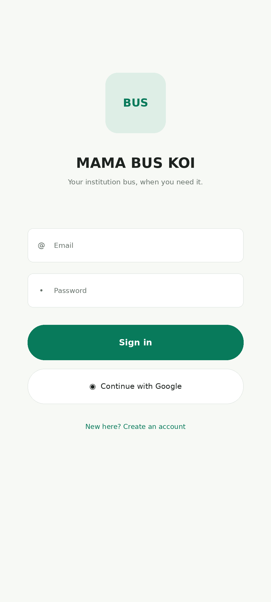
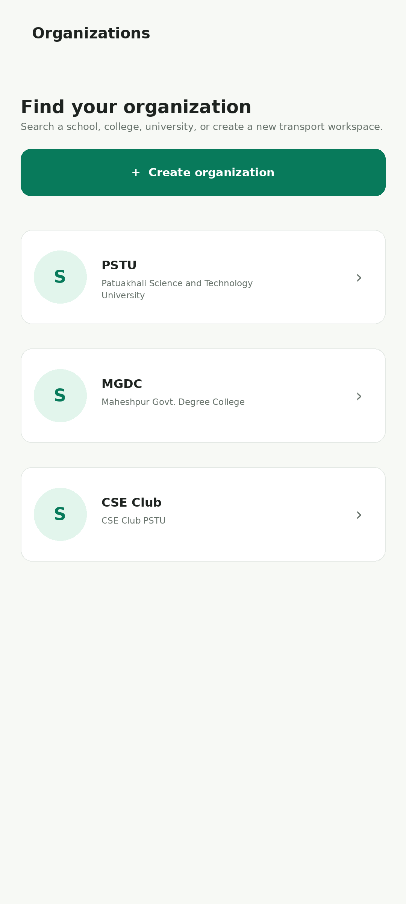
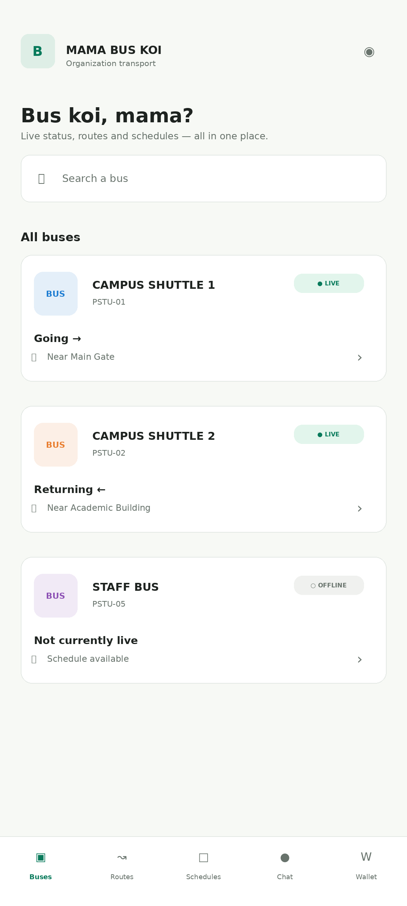
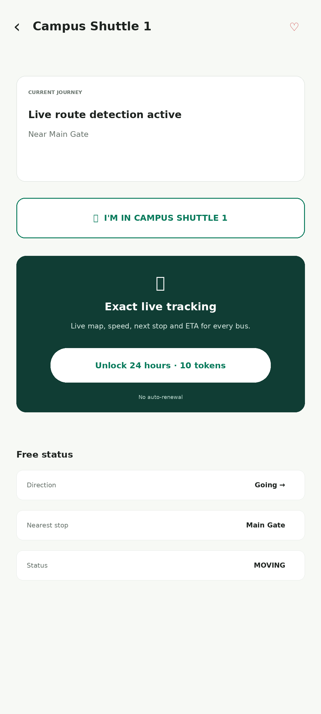
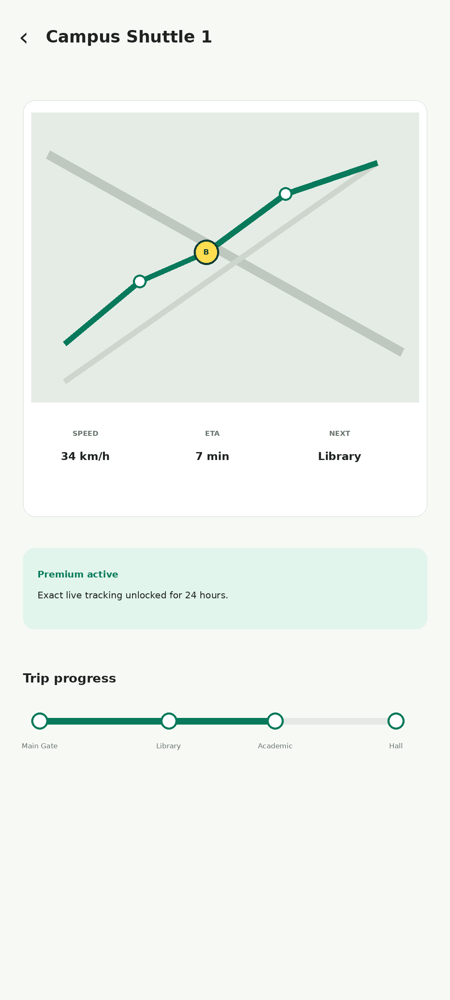
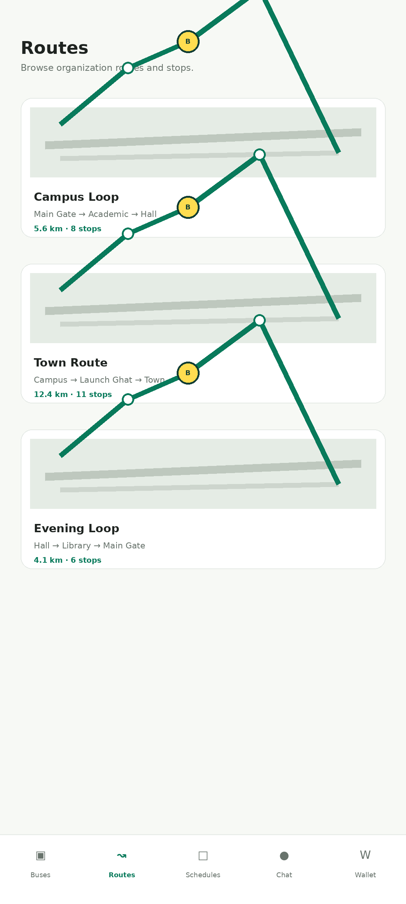
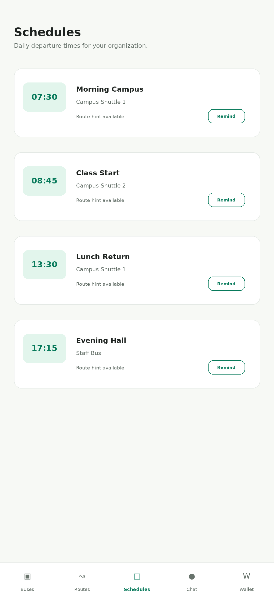
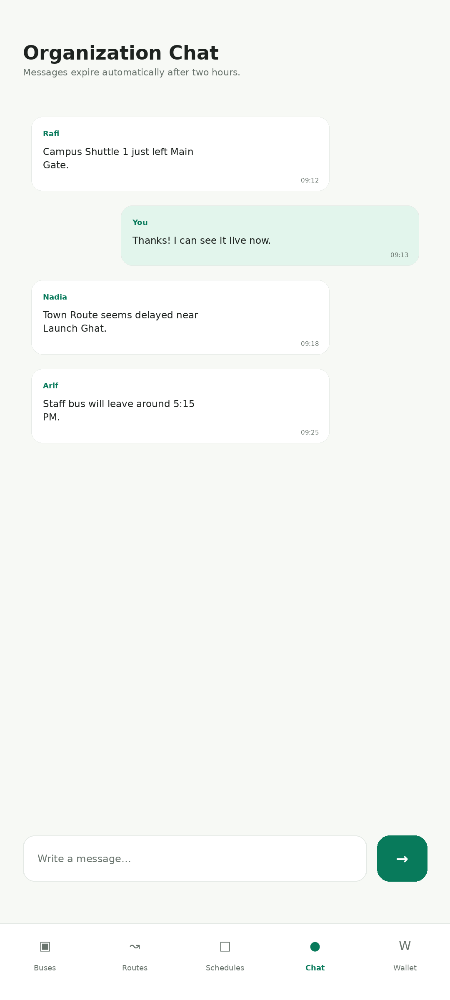
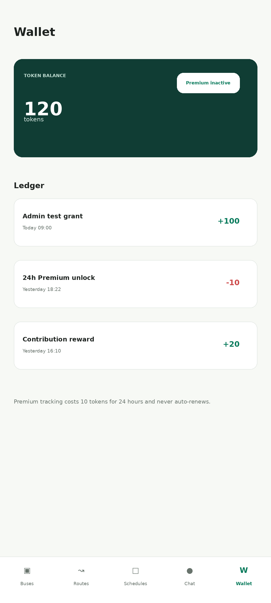
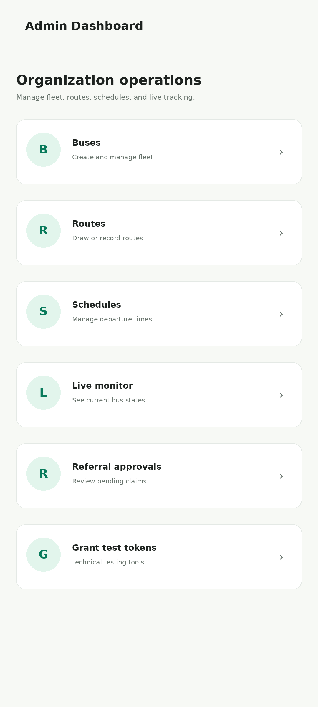

# Mama Bus Koi

**Bus status, routes, and schedules for your organization, in one place.**

Mama Bus Koi is an Android-first Flutter app for schools, colleges, universities, and other organizations. Members can find their bus, check its status, plan around departure schedules, and help others by sharing their location while onboard.

Each organization has its own workspace, fleet, routes, memberships, and chat. Tracking is crowdsourced: an authorized member taps **I'm in this bus** to become a location contributor. A bus is linked to a route only during an active trip.

> This repository contains an MVP designed around Firebase's zero-billing tier. Live deployment requires Firebase configuration and a trusted membership-mirroring process. Real-money purchases are not implemented.

## App mockups

These mockups illustrate the app's main screens using sample data. They are design previews, not evidence of a deployed live service. Click any image to view it at full size.

<table>
  <tr>
    <th>Sign in</th>
    <th>Organizations</th>
  </tr>
  <tr>
    <td><a href="mockups/01_login.png"></a></td>
    <td><a href="mockups/02_organizations.png"></a></td>
  </tr>
  <tr>
    <th>Bus list</th>
    <th>Bus details and tracking access</th>
  </tr>
  <tr>
    <td><a href="mockups/03_buses_home.png"></a></td>
    <td><a href="mockups/04_bus_details_locked.png"></a></td>
  </tr>
  <tr>
    <th>Premium live tracking</th>
    <th>Routes</th>
  </tr>
  <tr>
    <td><a href="mockups/05_premium_live_tracking.png"></a></td>
    <td><a href="mockups/06_routes.png"></a></td>
  </tr>
  <tr>
    <th>Schedules</th>
    <th>Organization chat</th>
  </tr>
  <tr>
    <td><a href="mockups/07_schedules.png"></a></td>
    <td><a href="mockups/08_chat.png"></a></td>
  </tr>
  <tr>
    <th>Wallet</th>
    <th>Admin dashboard</th>
  </tr>
  <tr>
    <td><a href="mockups/09_wallet.png"></a></td>
    <td><a href="mockups/10_admin_dashboard.png"></a></td>
  </tr>
</table>

## Features

| For members | For administrators |
| --- | --- |
| Email/password and native Android Google sign-in | Organization creation and workspace management |
| Organization discovery, joining, and switching | Fleet management without permanent route assignments |
| Bus search, favorites, and free coarse status | Route drawing, foreground GPS recording, and ordered stops |
| Routes, departure schedules, and local reminders | Schedule management and live bus monitoring |
| Exact selected-bus tracking with eligible access | Test-token grants and referral approval |
| Explicit onboard location sharing | Debug-only GPS simulator |
| Token wallet, transaction ledger, and referral claims | Platform, owner, and organization-admin roles |
| Organization chat with two-hour message expiry | Organization-scoped data and authorization |

Drift caches static data for offline use. Maps use MapLibre GL with OpenFreeMap. Schedule reminders are local; automatic server-triggered FCM notifications are deferred.

### How tracking works

1. An authorized member selects a bus and confirms **I'm in this bus**.
2. The Android foreground service collects GPS samples and displays an ongoing notification with a stop action.
3. Contributors coordinate through a primary-source lease lasting 60 seconds, renewed every 20 seconds. Standby contributors can take over after it expires.
4. The tracking engine matches samples to routes and calculates direction, progress, nearest/next stop, ETA, and movement status.
5. Members receive coarse status through `bus_status`. Exact coordinates use a separate `bus_live` stream for premium users, contributors, and admins.

Free status contains no latitude or longitude. The app does not store raw personal GPS history, and stale cached coordinates are not presented as current live data.

### Tokens and premium

- A premium pass costs **10 tokens**, lasts **24 hours**, and does not renew automatically.
- Admins can grant test tokens; changes are recorded in a transaction ledger.
- Admin approval of a referral claim grants the referrer **50 test tokens**.
- Real-money token purchasing is disabled. Value-bearing payments and rewards require a trusted backend before monetization.

## Technology

| Layer | Technology |
| --- | --- |
| Application | Flutter / Dart |
| State and navigation | BLoC / Cubit, go_router |
| Authentication | Firebase Authentication |
| Static cloud data | Cloud Firestore |
| Live tracking and coordination | Firebase Realtime Database |
| Offline storage | Drift / SQLite |
| Maps | MapLibre GL / OpenFreeMap |
| Background location | Native Kotlin foreground service / fused location provider |
| Notifications | flutter_local_notifications; FCM package prepared |
| Tests | Flutter Test, BLoC Test, Mocktail |

## Getting started

### Prerequisites

- Flutter with Dart compatible with `^3.12.2`, as declared in [pubspec.yaml](pubspec.yaml).
- Android Studio, Android SDK 36+, and Java 21 for the Android toolchain.
- A Firebase project with Authentication, Cloud Firestore, and Realtime Database.
- Firebase CLI for rule deployment; FlutterFire CLI if regenerating platform configuration.

Android is the primary target. Other platform folders are included, but they do not imply equivalent tracking support. Linux Firebase initialization is unsupported.

### 1. Clone and install dependencies

```bash
git clone https://github.com/Azrul16/Mama-Bus-Koi-AFlutterBusTrackingMobileApp.git
cd Mama-Bus-Koi-AFlutterBusTrackingMobileApp
flutter doctor
flutter pub get
dart run build_runner build
```

The project uses local compatibility forks of `firebase_database` and `maplibre_gl` in `third_party/` for AGP 9 built-in Kotlin integration. Keep these folders when cloning or building.

### 2. Configure Firebase

Copy [.env.example](.env.example) to `.env` and replace its placeholders with your Firebase client configuration:

```powershell
# PowerShell
Copy-Item .env.example .env
```

```bash
# macOS / Linux
cp .env.example .env
```

The `.env` file uses **JSON syntax**, loaded through `--dart-define-from-file`. [lib/firebase_options.dart](lib/firebase_options.dart) reads the platform values and reports missing configuration at startup.

In Firebase Console:

1. Register the Android app with application ID `com.example.buskoi`.
2. Enable Email/Password and Google authentication.
3. Register debug and release SHA-1/SHA-256 fingerprints for native Google sign-in.
4. Download the matching `google-services.json` to `android/app/google-services.json`.
5. Create Firestore and Realtime Database, and configure the Firebase CLI to target your project.
6. Review and deploy the included security rules:

```bash
firebase deploy --only firestore:rules,database
```

Rule sources: [firestore.rules](firestore.rules) and [database.rules.json](database.rules.json).

Keep `.env`, platform Firebase configuration files, Admin SDK credentials, signing keys, and `android/key.properties` out of Git. Dart defines are compiled into the client and cannot protect server secrets. Restrict Firebase client API keys and enforce access through Authentication, Security Rules, and App Check.

### 3. Set up organization access

Register an account, complete the profile, and choose **Create organization**. The creator receives organization-owner membership. Public organizations can be joined directly; trusted invite and approval workflows for other join policies still need backend implementation.

**Required for live tracking:** Firestore is the membership source of truth, but Realtime Database rules cannot read Firestore. A trusted backend or Firebase extension must mirror active memberships to:

```text
organization_memberships/{organizationId}/{uid}
```

Client writes to this authorization mirror are denied. Live tracking for newly joined members depends on this trusted synchronization; do not relax the rules to bypass it.

Owners can then add buses, draw or record routes, define ordered stops, create departure schedules, and grant test tokens. Schedule bus/route IDs are hints and do not permanently bind a bus to a route. Platform-admin access must be provisioned in a trusted environment through `users/{uid}.role`; clients cannot grant it.

### 4. Run or build

```bash
flutter run --dart-define-from-file=.env
flutter build apk --debug --dart-define-from-file=.env
```

Debug APK output: `build/app/outputs/flutter-apk/app-debug.apk`.

For a release build:

```bash
flutter build apk --release --dart-define-from-file=.env
```

Configure production signing before distribution: the current Android release build uses the debug signing configuration.

## Project structure

The app follows feature-first clean architecture. Presentation uses BLoCs/Cubits and repository contracts, with Firebase and Drift implementations in the data layer.

```text
lib/
  app/                  App composition, routing, and splash
  core/                 Database, dependency wiring, maps, location, utilities
  features/
    admin/              Organization and platform administration
    auth/               Sign-in and profile completion
    buses/              Fleet browsing and main navigation
    chat/               Organization chat
    favorites/          Saved buses
    institution/        Organizations and memberships (legacy folder name)
    referrals/          Referral claims and approval
    routes/             Routes and stops
    schedules/          Departure schedules
    tracking/           GPS contribution and tracking engines
    wallet/             Tokens, ledger, and premium access
  firebase_options.dart Environment-based Firebase configuration
  main.dart             Application entry point
mockups/                README design previews
test/                   Authentication, bus, and tracking tests
third_party/            Android plugin compatibility forks
```

Operational data is scoped by `organizationId`; authorization depends on active membership. Personal wallets and organization subscriptions are separate models. Firestore stores profiles, organizations, fleet data, routes, schedules, and chat. Realtime Database stores live status, exact bus locations, contributors, source leases, active trips, trip summaries, and wallet transactions.

Chat expires after two hours. Connected clients hide and purge expired messages; managed Firestore TTL is not enabled in this zero-billing setup, so server-side cleanup while all clients are offline remains a deployment consideration.

## Validation

```bash
dart format --output=none --set-exit-if-changed lib test
flutter analyze
flutter test
flutter build apk --debug --dart-define-from-file=.env
```

Tests cover authentication state, bus filtering, geometry, route matching and ambiguity, direction, stops, ETA, GPS freshness, arrival, source-lease expiry, and premium expiry.

For a live pilot, use three Android devices: one contributor, one viewer, and one standby contributor. Check background sharing under screen lock, free versus premium visibility, takeover after the primary contributor disconnects, and reverse-direction/arrival/GPS-loss behavior. Admin debug builds include a GPS simulator for controlled scenarios.

After changing Drift tables, regenerate code with `dart run build_runner build`, increment the schema version, and provide a migration.

## Current limitations

- Firebase provider setup, SHA registration, rule deployment, membership mirroring, and physical multi-phone testing require external configuration.
- Non-public organization invite/approval workflows need trusted backend support.
- Real-money payments and payment-grade rewards are not implemented.
- Server-triggered FCM notifications are deferred; schedule reminders are local.
- Android battery restrictions vary by vendor; validate background tracking on supported devices.
- Route-matching thresholds in [TrackingConfig](lib/core/config/tracking_config.dart) need calibration against real routes.
- Public OpenFreeMap availability is an external dependency.

See [IMPLEMENTATION_STATUS.md](IMPLEMENTATION_STATUS.md) for the implementation checklist and [IMPLEMENTATION_PLAN.md](IMPLEMENTATION_PLAN.md) for the technical plan.

## License

No license has been selected. Add a `LICENSE` before distributing the project or accepting external contributions.
